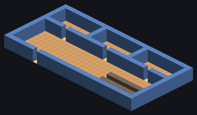
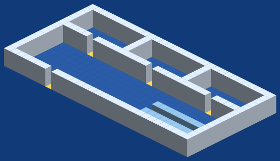

# PaTeX (Pentaract-Pexil TeX)

> **The ASCII Equivalent of LaTeX for 5D Geometric Topology & Discrete Spatial Manifolds**

[](06_PATEX_5D_GEOMETRIC_TYPESETTING.md)
[](#mathematical-overview)
[](#true-21-dimetric-axonometry)
[](#accessibility--screen-reader-linearization)

---

## Overview

**PaTeX** (Pentaract-Pexil $\TeX$) is an algebraic typesetting language and deterministic rasterization grammar designed to represent high-dimensional discrete spatial structures within bounded monospace terminal surfaces.

While traditional document preparation systems ($\TeX$, $\LaTeX$) excel at formatting 1D linear text streams and mathematical equations, they lack intrinsic spatial dimensionality and discrete topological connectivity. PaTeX establishes a formal, lossless bijection between a **5-dimensional manifold ($M^5 \cong S^4 \times \mathbb{Z}^5$)** and **71-column ASCII/Unicode monospace viewports**:

$$\mathcal{P}: M^5 \longleftrightarrow \Sigma^{71 \times 48}$$

---

## Render a Plan (Run Guide)

PaTeX ships a small renderer: a box-drawing ASCII plan in, a 2:1 isometric PNG out. It has zero dependencies and uses only integer math, so the same plan always gives the same image.

**1. Install Rust** (once): https://rustup.rs

**2. Get the renderer**

```bash
git clone https://github.com/13forge/PaTeX && cd PaTeX
```

```bash
cargo build --release
```

**3. Render the example**

```bash
./target/release/patex examples/two_bedroom.txt -o out.png
```

For the blueprint look:

```bash
./target/release/patex examples/two_bedroom.txt --style blueprint --tile 24 --elev 12 -o blueprint.png
```

On Windows the binary is `target\release\patex.exe`.

**4. Check your build matches ours** (renders both examples and compares them byte for byte with the PNGs in `examples/`)

```bash
cargo test
```

### Example: input and expected output

`examples/two_bedroom.txt` (31×15):

```text
┌─────────┬─────────┬─────────┐
│.........│.........│.........│
│.........│.........│.........│
│.........│.........│.........│
│.........│.........│.........│
├────+────┴────+────┴────+────┤
│.............................│
│.............................│
│.............................│
│...................▓▓▓▓▓▓▓▓..│
│.............................│
│...................▓▓▓▓▓▓▓▓▓▓│
│.............................│
│.............................│
└──────+──────────────────────┘
```

| default (`examples/two_bedroom.png`) | `--style blueprint --tile 24 --elev 12` (`examples/two_bedroom_blueprint.png`) |
|---|---|
|  |  |

### Plan glyphs

| glyph | meaning | drawn as |
|---|---|---|
| `┌ ─ ┐ │ └ ┘ ├ ┤ ┬ ┴ ┼` and doubles `╔ ═ ╗ ║ …` (all 44) | wall | block, 3 units tall |
| `+` | door | flat tile, set in a wall line |
| `.` | floor | flat tile |
| `░ ▒ ▓ █` | fill (counter, furniture, rock) | block, height by density (`▓` = 1, `█` = 2) |
| `◆ @ ~ #` | marks | flat tile |
| space, letters, `[ ]` | nothing / labels | left empty |

Rows may be up to 71 columns and 48 rows. A `.ptex` file works too: only its `\topology{ … }` body is read.

### Rules: sockets

The renderer draws whatever it is given, so a hole in a wall or a room with no door would still look real. `check` and `fix` stop that.

Every wall glyph has a **socket** on each edge (north, east, south, west). `┬` has sockets east, south and west. A socket must land on another wall or on a door (`+`). From that one rule:

| issue | meaning |
|---|---|
| broken wall | a socket points at floor, space or the sheet edge |
| stray door | a `+` with no wall on both sides of it |
| open to the outside | a room's floor reaches the edge of the plan: a wall or door is missing |
| no door path | a closed room with no chain of doors to the outside |

```bash
./target/release/patex check examples/broken.txt
```

```text
  row 0 col 10: broken wall, its N side connects to nothing
  row 5 col 4: broken wall, its E side connects to nothing
  ...
  row 1 col 1: room is open to the outside (missing wall or door)
  row 1 col 11: room of 36 cells has no door path to the outside
invalid: 9 issue(s), 1 room(s)
```

`fix` repairs what it can: a gap of up to 4 cells between two wall sockets becomes a door, every wall glyph is redrawn to match its neighbours, and each sealed room gets a door in the middle of its longest wall shared with a reachable room.

```bash
./target/release/patex fix examples/broken.txt -o fixed.txt
```

```text
fixed: 3 gap(s) bridged, 1 wall glyph(s) redrawn, 1 door(s) added
valid: 4 room(s)
```

`check` exits 0 for a valid plan and 1 otherwise, so it can score generated plans directly (valid-output rate). `render --fix` repairs in memory before drawing.

### Building: drop a piece at the cursor

`drop` places a piece centred on a cell, the way an editor drops one at the mouse. The piece slides up to 2 cells to share walls with what is already there (no double-thick walls), then the socket rules redraw the walls and cut the doors. The plan is valid after every drop.

```bash
printf '' | ./target/release/patex drop - --room 8x5 --at 4,6 -o plan.txt
```

```bash
./target/release/patex drop plan.txt --room 7x5 --at 4,14 -o plan.txt
```

```bash
./target/release/patex drop plan.txt --fill 3x1 --at 3,6 -o plan.txt
```

```text
   ┌───+──┬─────┐
   │.▓▓▓..│.....│
   │......+.....│
   │......│.....│
   └──────┴─────┘
```

`gen` builds a random plan the same way, with rooms dropped at seeded cursor positions. The same seed always gives the same plan (`examples/gen_seed7.txt`).

```bash
./target/release/patex gen --seed 7 --rooms 5 -o plan.txt
```

### Options

```text
patex render <plan> [-o out.png] [--fix] [--tile N] [--elev N] [--pad N] [--style canonical|blueprint]
patex check  <plan>
patex fix    <plan> [-o fixed.txt]
patex drop   <plan> --at ROW,COL (--room WxH | --fill WxH [--glyph C]) [--cols N --rows N] [-o out.txt]
patex gen    [--seed N] [--cols N] [--rows N] [--rooms N] [-o plan.txt]
```

`<plan>` may be `-` to read stdin, so an LLM's output can be piped straight in.

### As a library

```rust
let (plan, stats) = patex::Plan::parse(text);
let (image, _) = patex::render(&plan, &patex::Options::default());
std::fs::write("out.png", patex::encode_png(&image))?;

let mut grid = patex::Grid::parse(text);
let report = patex::check(&grid);          // report.is_valid(), report.issues
patex::fix(&mut grid);                     // gaps -> doors, walls redrawn, doors cut
patex::drop_at(&mut grid, patex::Piece::Room { w: 8, h: 5 }, row, col); // at the cursor
```

---

## Key Features

- **5-Dimensional Manifold ($M^5$):** Unifies spatial coordinates $(x, y, z)$, temporal causality phases $(t)$, and semantic functional lanes $(s)$ in a single balanced ternary tensor $\mathbf{p} \in \{-1, 0, +1\}^5$.
- **Continuous $S^4$ Hypersphere Apertures:** Models continuous camera perspectives and hyper-dimensional mood vectors via 4-angle hyperspherical coordinates $(\theta_1, \theta_2, \theta_3, \phi)$ with exact 5D unit vector embedding.
- **44-Glyph Unicode Box-Drawing Algebra:** Evaluates 4-connected spatial neighbor tensors $(N, E, S, W)$ directly into single, double, and mixed junctions via a closed-form radix-3 connectivity key:
  $$\text{Key}(\mathbf{N}) = N + 3E + 9S + 27W$$
- **True 2:1 Dimetric Axonometry:** Derives an exact integer 2:1 slope ($\text{RUN} = 2, \text{RISE} = 1$) directly from the ternary lattice, avoiding floating-point sine/cosine evaluations and trigonometric drift.
- **Screen-Reader Linearization:** Built-in structural accessibility that compresses consecutive material runs and applies the *void silence invariant* for fluid auditory terminal telemetry.

---

## Syntax Example (`.ptex`)

```patex
\begin{patex}
\chamber{VAULT_SANCTUM}
\stratum{-1}
\phase{Present}
\density{0.8400}

\topology{
  ╔═════════════════════════════════════════════════════════════════════╗
  ║ [STRATUM -1: VAULT SANCTUM]                   [PHASE: T0 PRESENT]   ║
  ╠═════════════════════════════════════════════════════════════════════╣
  ║  ┌─[NORTH PORTAL]─┐                                                 ║
  ║  │ . . . . . . . .│ . . . . . . . . . . . . . . . . . . . . . . .   ║
  ║  │ . . ┌─────┐ . .│ . . . . . . . . . . . . ┌─────┐ .               ║
  ║  │ . . │ (1) │ . .│ . . . [ALTAR] . . . . . │ (2) │ .               ║
  ║  │ . . └─────┘ . .│ . . .  0x8F2C . . . . . └─────┘ .               ║
  ║  │ . . . . . . . .│ . . . . . . . . . . . . . . . . . . . . . . .   ║
  ║  └─┬─────────────┬┘                                                 ║
  ║    │             │                                                 ║
  ║    └──────[SIGHT]┘                                                 ║
  ╚═════════════════════════════════════════════════════════════════════╝
}
\end{patex}
```

---

## Mathematical Overview

### 1. Horner Radix-3 Lattice Packing
The 243 discrete interior states of a 5D balanced ternary cell $(t_0, t_1, t_2, t_3, t_4) \in \{-1, 0, +1\}^5$ are packed into a single linear byte index $I \in [0, 242]$ via Horner's rule:

$$I = (t_0 + 1) + 3 \Big( (t_1 + 1) + 3 \Big( (t_2 + 1) + 3 \Big( (t_3 + 1) + 3 (t_4 + 1) \Big) \Big) \Big)$$

### 2. Disjoint Lane Partitioning
The fifth trit $t_4$ partitions the 243 states into three mutually exclusive 81-state domains:
1. **Material Lane ($t_4 = -1$, $I \in [0, 80]$):** Occlusion fields, mist, haze, and structural boundaries.
2. **Topology Lane ($t_4 = 0$, $I \in [81, 161]$):** 4-connected single and double box-drawing geometry.
3. **Mark Lane ($t_4 = +1$, $I \in [162, 242]$):** Semantic altars, entity anchors, floor symbols, and flux bands.

### 3. Continuous $S^4$ Hypersphere Embedding
For continuous orientations and light transport, points on the 4-sphere $S^4 \subset \mathbb{R}^5$ project into 5D unit space:

$$x_1 = \cos\theta_1$$
$$x_2 = \sin\theta_1 \cos\theta_2$$
$$x_3 = \sin\theta_1 \sin\theta_2 \cos\theta_3$$
$$x_4 = \sin\theta_1 \sin\theta_2 \sin\theta_3 \cos\phi$$
$$x_5 = \sin\theta_1 \sin\theta_2 \sin\theta_3 \sin\phi$$

$$\sum_{i=1}^{5} x_i^2 = 1$$

---

## Documentation

- **[Full Conceptual Whitepaper](06_PATEX_5D_GEOMETRIC_TYPESETTING.md):** Complete mathematical derivations, the 44-glyph box-drawing table, multi-view section cuts, and screen-reader linearization algorithms.

---

## Citation

If you use PaTeX in your research or software, please cite:

```bibtex
@article{patex2026,
  title   = {PaTeX: The ASCII Equivalent of 5D LaTeX for Hyper-Dimensional Topology and Discrete Manifolds},
  author  = {The 13Forge Architecture Group},
  year    = {2026},
  journal = {Technical Whitepaper Series},
  volume  = {6},
  url     = {https://github.com/13forge/PaTeX}
}
```

If you use the renderer in a project, a one-line credit is enough:

> Isometric rendering by PaTeX (13Forge), https://github.com/13forge/PaTeX, Apache-2.0.

---

## License

Apache-2.0 (see `LICENSE`).
